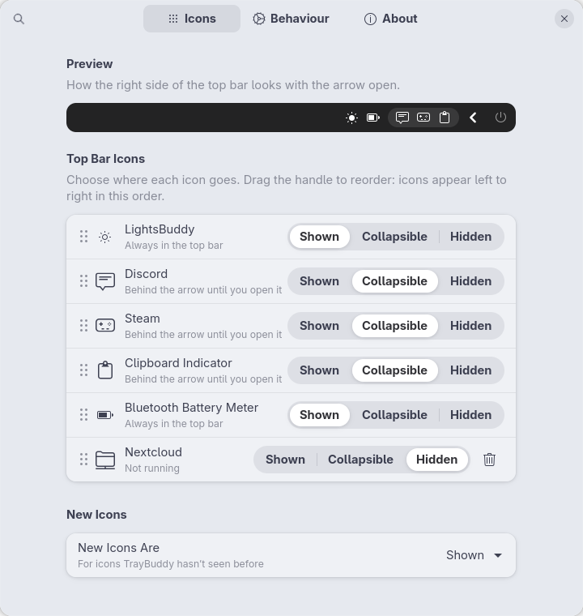
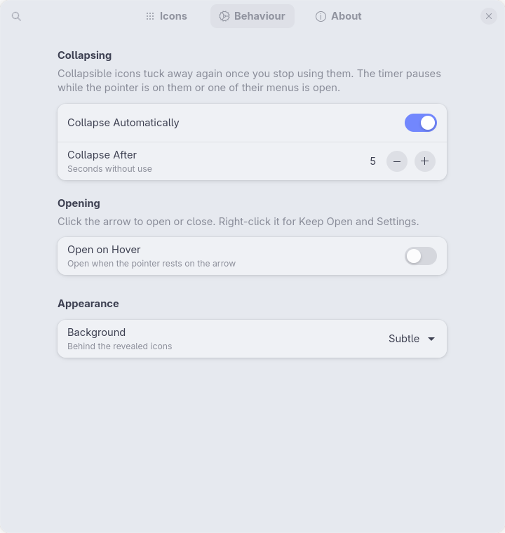

<p align="center">
  
</p>

# TrayBuddy

**Tidy up the GNOME top bar: keep the icons you need in view and tuck the rest behind an arrow that slides them out when you want them.**

[](https://release.gnome.org/51/)
[](LICENSE)
[](https://github.com/Svashtar/traybuddy-gnome/actions/workflows/ci.yml)

> **Status: early development.** There is no release yet. Follow the [changelog](CHANGELOG.md) for progress.

<p align="center">
  
</p>

## Introduction

Tray icons pile up: chat apps, game launchers, sync clients, plus the icons other extensions add. TrayBuddy lets you decide, icon by icon, what happens to each one:

- **Shown:** always in the top bar, like today.
- **Collapsible:** tucked away behind a small arrow. Click the arrow and they slide out in a soft pill; leave them alone for a few seconds and they slide back.
- **Hidden:** never shown.

You also choose the order, by dragging icons in the settings.

## Why?

- **A calmer top bar.** Most tray icons are only needed now and then. They don't need to be on screen all day.
- **Up to date with GNOME.** TrayBuddy is built for GNOME Shell 51 and later, so you don't have to wait for older extensions to catch up with each GNOME release.
- **Inspired by [Lilypad](https://github.com/shendrew/Lilypad)**, with a few things it can't do: icons that are never shown, icons remembered while their app isn't running, a live preview, and a gentler animation.

## Features

- **Three states per icon:** Shown, Collapsible or Hidden.
- **Drag to reorder** icons in the settings, with a live preview of how the top bar will look.
- **Animated arrow.** It turns when the drawer opens or closes, and the icons slide out one after another inside a pill.
- **Auto-collapse** after a number of seconds you choose (1–120). The timer waits while the pointer is on the icons or one of their menus is open, so the drawer never closes under you.
- **Open on hover** (optional) and **Keep Open** from the arrow's right-click menu.
- **Pill background:** none, subtle, or your accent colour.
- **Arrow position:** next to the system menu (after your shown icons) or before them.
- **Works with app tray icons** (Discord, Steam, Nextcloud…, through the AppIndicator extension) **and with icons from other extensions.** System menus and the screen recording and sharing indicators are never touched.
- **Remembers icons of apps that aren't running**, so you can set them up before you start the app, or forget them.
- **Real app names and icons**, read from each app's `.desktop` file, with **Rename** for anything you'd rather call something else.
- **Works with Dash to Panel.**
- **Helpful About page.** Release notes, links to the docs, settings export/import and a *Copy Debug Info* button for bug reports.

## Screenshots

<p align="center">
  
</p>

## Requirements

- **GNOME Shell 51 or later.** Older versions are not supported.
- *Optional:* the [AppIndicator and KStatusNotifierItem Support](https://extensions.gnome.org/extension/615/appindicator-support/) extension, to get application tray icons into the top bar in the first place.

## Installation

### From extensions.gnome.org

*Coming soon.* Once the extension has been reviewed, it will be installable with one click from [extensions.gnome.org](https://extensions.gnome.org/) or the Extension Manager app.

### From a release zip

1. Download `traybuddy@svashta.com.shell-extension.zip` from the [latest release](https://github.com/Svashtar/traybuddy-gnome/releases/latest).
2. Install it:

   ```sh
   gnome-extensions install --force traybuddy@svashta.com.shell-extension.zip
   ```

3. Log out and back in (on Wayland GNOME Shell can't be restarted in place).
4. Enable it:

   ```sh
   gnome-extensions enable traybuddy@svashta.com
   ```

### From source

You need `git`, `make` and `glib-compile-schemas` (from the GLib development tools, usually already installed).

```sh
git clone https://github.com/Svashtar/traybuddy-gnome.git
cd traybuddy-gnome
make install
```

`make install` symlinks `src/` into `~/.local/share/gnome-shell/extensions/traybuddy@svashta.com`. Log out and back in, then run `gnome-extensions enable traybuddy@svashta.com`. To remove it again, run `make uninstall`.

> **Using Lilypad or another top-bar organiser?** Turn it off first. Two extensions moving the same icons around will fight each other.

## Quick start

1. **Open the settings** (Extensions app → TrayBuddy → Settings, or right-click the arrow → Settings). Every icon currently in the top bar is listed on the **Icons** page.
2. **Pick a state for each icon:** *Shown*, *Collapsible* or *Hidden*. The arrow appears in the top bar as soon as one icon is collapsible.
3. **Drag the handle** next to an icon to change the order. The preview at the top shows the result.
4. *Optional:* on the **Behaviour** page, change how long the drawer stays open, turn on *Open on Hover* or pick a different background.

The full walk-through is in [Getting started](docs/getting-started.md).

## Documentation

| Guide | What it covers |
|---|---|
| [Getting started](docs/getting-started.md) | First run, icon states, ordering, behaviour settings |
| [Troubleshooting](docs/troubleshooting.md) | Missing icons, icons that won't hide, conflicts with other extensions, collecting logs |
| [Privacy](docs/privacy.md) | What TrayBuddy stores and what the debug info contains |
| [Architecture](docs/architecture.md) | How the extension is built (for contributors) |

## FAQ

**Why isn't my app's icon listed?**
TrayBuddy manages icons that are already in the top bar. Most apps need the AppIndicator extension to show a tray icon on GNOME. Icons in the left or centre of the top bar (for example when AppIndicator's *Tray position* is set to left) are not managed.

**An app's icon is listed twice.**
Two icons with the same name get a number (`#2`). This happens with apps that create more than one tray icon.

**Can I hide the clock or the system menu?**
No. TrayBuddy only manages extension and app icons. System menus and the screen recording and sharing indicators always stay visible.

**Does it work with Dash to Panel?**
Yes, on the primary panel, where Dash to Panel shows tray icons.

## Privacy

TrayBuddy makes no network connections and has no telemetry. It stores the names and icons of the top-bar icons it has seen in your GNOME settings, so the settings window can list them. Debug info counts app icons but never names them. Details are in [Privacy](docs/privacy.md).

## Contributing

Bug reports and pull requests are welcome. Please read [CONTRIBUTING.md](CONTRIBUTING.md) first. When reporting a bug, open **Settings → About → Copy Debug Info** and paste the result into the [bug report form](https://github.com/Svashtar/traybuddy-gnome/issues/new/choose).

## Translations

TrayBuddy is in English only. Every string is ready for gettext ([`po/traybuddy.pot`](po/traybuddy.pot)), so if you'd like it in your language, see [CONTRIBUTING.md → Translations](CONTRIBUTING.md#translations).

## License

TrayBuddy is free software, released under the [GNU General Public License, version 2 or later](LICENSE) (GPL-2.0-or-later).

---

<p align="center">
  <a href="https://svashta.com">
    <picture>
      <source media="(prefers-color-scheme: dark)" srcset="docs/assets/svashta-wordmark-light.svg">
      
    </picture>
  </a>
  <br><sub>Made by <a href="https://svashta.com">Svashta</a></sub>
</p>
